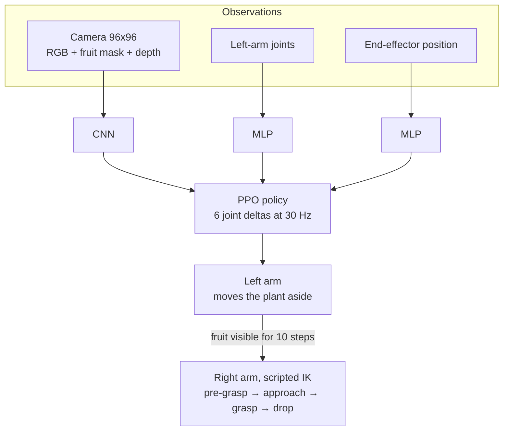
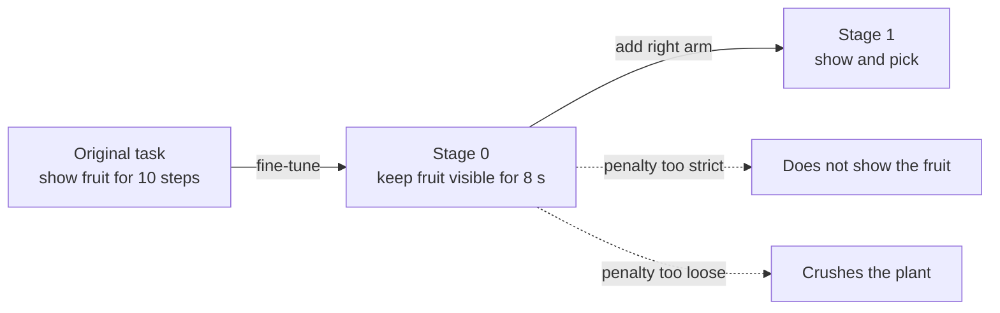

<div class="row justify-content-center">
  <div class="col-sm-12 col-md-10">
    
  </div>
</div>
<div class="caption">The left arm moves the plant aside. The right arm picks the fruit.</div>

## Overview

A MyBuddy robot has two arms. The left arm learns with RL to push a plant aside and keep a hidden fruit visible. The right arm then
picks the fruit.

The environment comes from [Find the Fruit](https://hjy77.github.io/find_the_fruit/) (ICRA 2026). I moved it to Isaac Lab 3.0,
trained the left arm to hold the plant open, and added the right arm.

For the full settings, rewards and usage, refer to the [repository README](https://github.com/ManojBhatta/find_and_pick).

## System



## Training stages



The original task teaches a fast sweep. After the sweep, the plant springs back.

<div class="row justify-content-center">
  <div class="col-sm-10 col-md-8">
    <video width="100%" controls autoplay loop muted playsinline class="img-fluid rounded z-depth-1">
      <source src="{{ '/assets/video/projects/find_and_pick/clip_for_the_nominal_find_the_fruit_task.mp4' | relative_url }}" type="video/mp4">
      Your browser does not support the video tag.
    </video>
    <div class="caption">Original task: the arm sweeps through the plant. The plant springs back.</div>
  </div>
</div>

Stage 0 needs a balanced plant-displacement penalty.

<div class="row justify-content-center g-2">
  <div class="col-sm-6">
    <video width="100%" controls autoplay loop muted playsinline class="img-fluid rounded z-depth-1">
      <source src="{{ '/assets/video/projects/find_and_pick/learnedtocrush.mp4' | relative_url }}" type="video/mp4">
      Your browser does not support the video tag.
    </video>
    <div class="caption">Penalty too loose: the policy crushes the plant.</div>
  </div>
  <div class="col-sm-6">
    <video width="100%" controls autoplay loop muted playsinline class="img-fluid rounded z-depth-1">
      <source src="{{ '/assets/video/projects/find_and_pick/perspective_of_robot_only_moving_the_plant_aside.mp4' | relative_url }}" type="video/mp4">
      Your browser does not support the video tag.
    </video>
    <div class="caption">Final Stage 0: the arm bends the stalk aside and holds.</div>
  </div>
</div>

## Results

30 evaluation episodes, random fruit positions. Training used one 6 GB laptop GPU.

**Stage 0: show and hold (8 s)**

```chartjs
{
  "type": "bar",
  "data": {
    "labels": ["Success", "Visible at end", "Steps visible", "Steps with contact (lower is better)"],
    "datasets": [
      { "label": "Original reveal policy", "data": [3, 10, 12, 62.5], "backgroundColor": "rgba(150, 150, 150, 0.7)" },
      { "label": "Stage 0 policy", "data": [70, 67, 67, 17.5], "backgroundColor": "rgba(46, 160, 67, 0.8)" }
    ]
  },
  "options": {
    "scales": { "y": { "beginAtZero": true, "max": 100, "title": { "display": true, "text": "%", "color": "#888" }, "ticks": { "color": "#888" }, "grid": { "color": "rgba(128,128,128,0.2)" } }, "x": { "ticks": { "color": "#888" }, "grid": { "color": "rgba(128,128,128,0.2)" } } },
    "plugins": { "legend": { "position": "bottom", "labels": { "color": "#888" } } }
  }
}
```

**Stage 1: show and pick (10 s)**

```chartjs
{
  "type": "bar",
  "data": {
    "labels": ["Stage 0, no changes", "Fine-tune, large pick rewards", "Fine-tune, current rewards"],
    "datasets": [
      { "label": "Picked and delivered", "data": [22, 21, 20], "backgroundColor": "rgba(46, 160, 67, 0.8)" },
      { "label": "Fruit not shown", "data": [4, 6, 9], "backgroundColor": "rgba(220, 80, 60, 0.8)" },
      { "label": "Shown, not reached", "data": [4, 3, 1], "backgroundColor": "rgba(240, 170, 40, 0.8)" }
    ]
  },
  "options": {
    "indexAxis": "y",
    "scales": {
      "x": { "stacked": true, "max": 30, "title": { "display": true, "text": "Episodes (of 30)", "color": "#888" }, "ticks": { "color": "#888" }, "grid": { "color": "rgba(128,128,128,0.2)" } },
      "y": { "stacked": true, "ticks": { "color": "#888" }, "grid": { "display": false } }
    },
    "plugins": { "legend": { "position": "bottom", "labels": { "color": "#888" } } }
  }
}
```

The Stage 0 policy picks the most fruits (73%). The fine-tune with the current rewards is smoother and has ~5x less contact, but
it stops more on difficult fruit positions.

Each clip has three panels: perspective view · 96x96 policy camera (box = fruit mask, green bar = fruit visible) · plant mask
from depth.

<div class="row justify-content-center">
  <div class="col-12">
    <video width="100%" controls autoplay loop muted playsinline class="img-fluid rounded z-depth-1">
      <source src="{{ '/assets/video/projects/find_and_pick/this_shows_proper_fruit_occuluded_arm_moves_plant_smoothly_and_picks_up.mp4' | relative_url }}" type="video/mp4">
      Your browser does not support the video tag.
    </video>
    <div class="caption">Success: the fruit starts hidden. The left arm moves the plant aside and the right arm picks the fruit.</div>
  </div>
</div>

<div class="row justify-content-center">
  <div class="col-12">
    <video width="100%" controls autoplay loop muted playsinline class="img-fluid rounded z-depth-1">
      <source src="{{ '/assets/video/projects/find_and_pick/plant_springs_back_and_fails_to_move_plant_aside_again.mp4' | relative_url }}" type="video/mp4">
      Your browser does not support the video tag.
    </video>
    <div class="caption">Failure: the plant springs back. The arm cannot push it aside again.</div>
  </div>
</div>

## Next step

Train the right-arm pick with RL. Then one policy can control the two arms.

---

**Repository:** [github.com/ManojBhatta/find_and_pick](https://github.com/ManojBhatta/find_and_pick) ·
**Original work:** [Find the Fruit](https://hjy77.github.io/find_the_fruit/) (Subedi, Yang, Jha, Sarkar, ICRA 2026)
