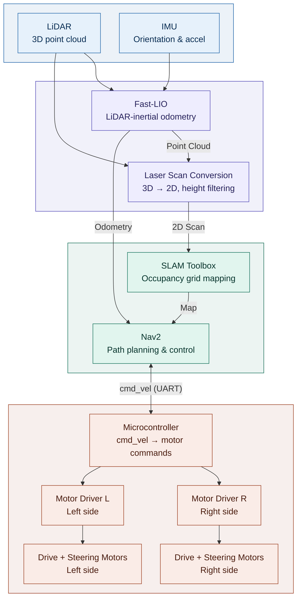

  

    <video width="100%" controls autoplay loop muted playsinline preload="auto" class="img-fluid rounded z-depth-1">
      <source src="{{ '/assets/video/projects/fyp/demo_vid.mp4' | relative_url }}" type="video/mp4">
      Your browser does not support the video tag.
    </video>
    

      The AGV autonomously mapping and navigating an outdoor environment.
    

  

## Overview

As part of our final year project, my team — Biswash Khatiwada, Susil Chhetri, Balkrishna Poudel, and I — designed and built an
Autonomous Ground Vehicle (AGV) capable of navigating unknown outdoor environments using LiDAR-based SLAM and the Nav2 navigation
stack.

| Compute                                     | Perception     | Low-level control               | Software                     |
| ------------------------------------------- | -------------- | ------------------------------- | ---------------------------- |
| Onboard laptop, ROS 2 Humble (Ubuntu 22.04) | 3D LiDAR + IMU | STM32 microcontroller over UART | Fast-LIO, SLAM Toolbox, Nav2 |

## My Contribution

- **Simulation:** Set up an accurate Gazebo simulation of the robot for testing SLAM and navigation before deployment on real
  hardware.
- **Embedded control:** Developed the low-level hardware interface on an STM32 microcontroller responsible for converting ROS 2
  `Twist` commands into motor commands, including motor kinematics and PID control.
- **Communication:** Wrote the ROS 2 node handling UART communication between the onboard PC and the STM32, including packet
  framing and robust serial data handling.
- **Navigation:** Tuned and tested Nav2 parameters for reliable path planning and obstacle avoidance.

## Implementation Approach and Details

### Hardware

The chassis was built by welding together the frames of two Segways to form the base of the AGV. An onboard laptop running ROS 2
Humble on Ubuntu 22.04 served as the robot's main compute, handling perception, localization, mapping, and navigation. A 3D LiDAR
provided the primary perception input, and an STM32 microcontroller handled all low-level motor control, communicating with the ROS
2 stack over UART.

    

        
    

    

        
    

    Electronics schematic (left) and the assembled hardware platform (right).

### System architecture

The overall system architecture is shown below:

  <i style="background:#E6F1FB;border-color:#185FA5"></i>Sensors
  <i style="background:#EEEDFE;border-color:#534AB7"></i>Perception &amp; Localization (Host PC)
  <i style="background:#E1F5EE;border-color:#0F6E56"></i>Autonomy Stack (ROS 2, onboard compute)
  <i style="background:#FAECE7;border-color:#993C1D"></i>Low-Level Control (Embedded)

### Perception and mapping

Fast-LIO was used to fuse the 3D LiDAR and IMU data into a real-time LiDAR-inertial odometry estimate, which grounded the robot's
pose during mapping and navigation. The resulting 3D point cloud was height-filtered and projected down to a 2D laser scan, which
SLAM Toolbox consumed to build the occupancy grid map used for localization and path planning.

### Control and navigation

On the navigation side, motor kinematics and PID control were implemented directly on the STM32, which received `cmd_vel`
(`Twist`) commands from the ROS 2 side over UART and converted them into per-wheel motor commands. Within Nav2, the default plugins
were used for planning and control:

| Role                       | Nav2 plugin        | Notes                                            |
| -------------------------- | ------------------ | ------------------------------------------------ |
| Local planner / controller | **DWB controller** | Dynamic Window Approach-based                    |
| Global planner             | **NavFn planner**  | Computes global paths using Dijkstra's algorithm |

Only a subset of parameters in the `nav2_params.yaml` file were tuned from their defaults — mainly costmap inflation, controller
velocity/acceleration limits, and goal tolerances — based on testing.

## Results

Since localization relied solely on 2D laser scan matching (no additional sensor fusion for pose correction), goal-reaching
accuracy varied noticeably with environment. Indoors, where structured features like walls and corners gave the scan matcher
plenty to work with, the robot reached its goal with a position error of about 20 cm. Outdoors, sparser and less consistent
features led to greater drift in localization, with goal position errors of around 50 cm.

    

        
    

    

        <table class="table table-sm mb-0">
            <thead><tr><th>Environment</th><th>Goal error</th></tr></thead>
            <tbody>
                <tr><td>Indoor</td><td><strong>~20 cm</strong></td></tr>
                <tr><td>Outdoor</td><td><strong>~50 cm</strong></td></tr>
            </tbody>
        </table>
    

    Difference between the commanded goal and the robot's actual stopping position, comparing indoor and outdoor runs
    (the robot was supposed to stop inside the four corners).

## Learnings

This project was a deep dive into the full autonomy stack including the ROS 2 framework, SLAM Toolbox and LiDAR-inertial SLAM, path
planning and navigation with Nav2, simulating the robot in Gazebo, and building and debugging the hardware and embedded electronics
end-to-end. Beyond the technical skills, it was also a great exercise in integrating perception, planning, and control into one
working system and of course it was a lot of fun to build (and ride the robot).

---

**Repository:** [github](https://github.com/manojbhatta/bail_gada) · **Final Thesis:** [pdf]({{ '/assets/pdf/fyp.pdf' | relative_url }})
