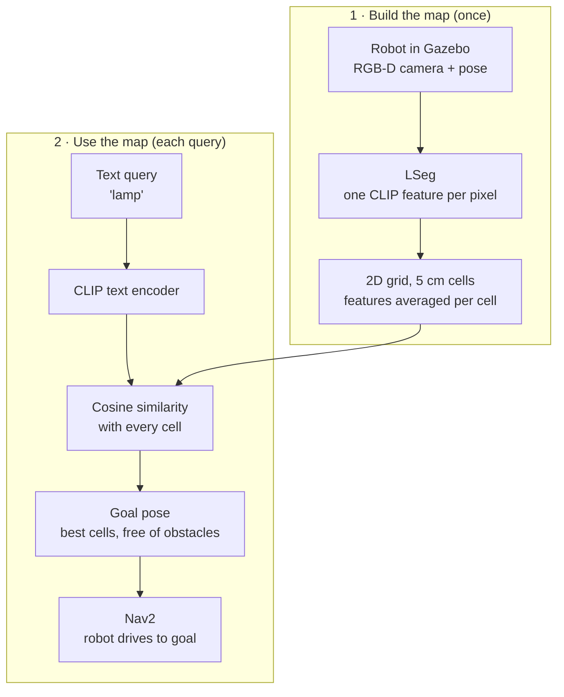

  

    <video width="100%" controls autoplay loop muted playsinline class="img-fluid rounded z-depth-1">
      <source src="{{ '/assets/video/projects/ov_nav/nav.mp4' | relative_url }}" type="video/mp4">
      Your browser does not support the video tag.
    </video>
    
The robot gets a text query. It plans a path and drives to the object.

  

## Overview

Most robot maps know only a fixed list of objects. This map stores a CLIP feature in each cell, not a label. Thus, you can ask for
any object in plain words, and the robot finds it with no new training.

The method comes from [VLMaps](https://vlmaps.github.io/) (ICRA 2023). I built it again for **ROS 2 Jazzy + Gazebo Harmonic**, not
the original Habitat simulator.

For the full setup and usage, refer to the [repository](https://github.com/manojbhatta/ov_nav).

## System

## The map

    

        
    

    

        
    

    

        
    

    

        
    

Gazebo living room · color top-down map · obstacle map · map with semantic categories.

## Ask with words

Each query gives a similarity heatmap over the full map. Yellow is high similarity. The red mark is the goal.

    

        
    

    

        
    

    

        
    

    

        
    

Queries: coffee table · sofa · rug · lamp. The same map answers all four.

## Why it works

CLIP puts images and text in the same feature space. Thus, a text query can point to the image areas that match it.

    

        
    

CLIP patch similarity for the query "rug": RGB · depth · 14x14 similarity grid · heatmap on the image.

## Lessons

- **Dense features are the hard part.** Raw CLIP patches are coarse and noisy. LSeg gives per-pixel features that are good for a
  map.
- **Grid settings change the map.** Cell size, depth sampling and camera height all move the floor and obstacle edges.
- **Sync the sensors yourself.** The approximate-time synchronizer stalled with Gazebo QoS. A simple closest-timestamp cache
  works and is easy to debug.
- **Align the frames.** The map starts at the robot start pose, but Nav2 uses the `map` frame. A static `tf2` transform is the
  correct fix.

---

**Repository:** [github.com/manojbhatta/ov_nav](https://github.com/manojbhatta/ov_nav) · **Based on:**
[VLMaps](https://vlmaps.github.io/) (Chen et al., ICRA 2023), LSeg (Li et al., CVPR 2022), Nav2, SLAM Toolbox and Gazebo.
