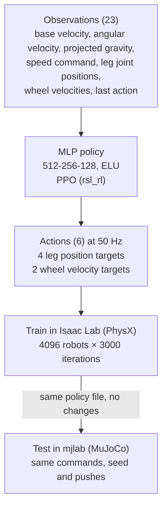

  

    <video width="100%" controls autoplay loop muted playsinline class="img-fluid rounded z-depth-1">
      <source src="{{ '/assets/video/projects/upkie/curriculum_isaaclab_pushes.mp4' | relative_url }}" type="video/mp4">
      Your browser does not support the video tag.
    </video>
    

      The Curriculum policy in Isaac Lab. It follows the speed command and recovers from random pushes. Top left: commanded (green) and
      actual (blue) speed and turn rate. Red box and arrow: a push.
    

  

## Overview

The goal of this project was to learn the full workflow to train a robot policy in Isaac Lab: set up the environment, design the
rewards, train, and test.

[Upkie](https://github.com/upkie/upkie), a wheeled biped, learns a velocity tracking task: drive at a commanded forward speed and
turn rate. I trained it with three different settings and tested how each setting changes:

- **Robustness:** how often the robot falls when something pushes it.
- **Sim-to-sim transfer:** how well the same policy works in a different simulator (MuJoCo, through mjlab), with no changes.

For the full setup, rewards and usage, refer to the repository. <!-- TODO: add the repository link -->

## Setup

**Rewards.** The policy gets a reward when it follows the commanded forward speed and turn rate. It gets penalties for:

- vertical motion, and roll or pitch rate
- a tilted trunk
- a trunk height different from 0.34 m
- large joint torques, joint accelerations and fast changes of action
- a fall (−200, and the episode stops)

**Three training settings.** All three use the same budget (3000 iterations × 4096 robots, about 45 min each). Commands are
±1.0 m/s forward and ±1.5 rad/s turn.

| Setting        | What the robot gets during training                                                                                                   |
| -------------- | ------------------------------------------------------------------------------------------------------------------------------------- |
| **Nominal**    | The full command range. No pushes.                                                                                                    |
| **Random**     | The full command range and random pushes (up to 1.6 m/s) every 5–10 s, from the start.                                                |
| **Curriculum** | Small commands and small pushes at the start. They increase gradually to the Random values by iteration ~2010 and then stay constant. |

  

    <video width="100%" controls autoplay loop muted playsinline class="img-fluid rounded z-depth-1">
      <source src="{{ '/assets/video/projects/upkie/nominal_isaaclab_pushes.mp4' | relative_url }}" type="video/mp4">
    </video>
    
Nominal

  

  

    <video width="100%" controls autoplay loop muted playsinline class="img-fluid rounded z-depth-1">
      <source src="{{ '/assets/video/projects/upkie/random_isaaclab_pushes.mp4' | relative_url }}" type="video/mp4">
    </video>
    
Random

  

  

    <video width="100%" controls autoplay loop muted playsinline class="img-fluid rounded z-depth-1">
      <source src="{{ '/assets/video/projects/upkie/curriculum_isaaclab_pushes.mp4' | relative_url }}" type="video/mp4">
    </video>
    
Curriculum

  

The three policies in Isaac Lab, with random pushes.

## Getting sim-to-sim to work
When I first moved the policy to MuJoCo with no changes, the robot behaved wierd to say the least. The two setups disagreed on many of these points. Thus, the policy got scrambled inputs and sent its commands to the wrong joints. These are the differences I found and
fixed:

| Problem                                                                                                                                          | Fix                                                                                                          |
| ------------------------------------------------------------------------------------------------------------------------------------------------ | ------------------------------------------------------------------------------------------------------------ |
| **Joint order.** MuJoCo lists joints one leg at a time. Isaac Lab groups them by depth in the tree. The right hip command went to the left knee. | Define one joint order in `sim2sim.py` (the MuJoCo order). Use it everywhere with `preserve_order=True`.     |
| **Motors and joints.** In Isaac Lab, the wheel damping was 40× too high. Joint friction and armature were not applied in PhysX.                  | Set stiffness, damping, maximum torque, friction and armature explicitly from `sim2sim.py`.                  |
| **Velocity.** Isaac Lab gave the velocity of the centre of mass in the robot frame. MuJoCo gave the trunk reference point in the world frame.    | Use the trunk reference point, in the robot frame, in both.                                                  |
| **Physics and timing.** Friction, reset noise and command ranges were different.                                                                 | Same friction range (0.6–1.2), same reset noise and commands. Physics at 200 Hz and policy at 50 Hz in both. |
| **Checkpoints.** mjlab normalized the inputs and Isaac Lab did not.                                                                              | Turn off input normalization. An Isaac Lab checkpoint now loads directly in mjlab.                           |

**Check.** With the same actions in both simulators, all 23 inputs agree within 0.08 for the first 0.1 s. After that they drift
slowly, because the two physics engines handle wheel–ground contact differently. The policy must tolerate this gap.

  

    <video width="100%" controls autoplay loop muted playsinline class="img-fluid rounded z-depth-1">
      <source src="{{ '/assets/video/projects/upkie/nominal_isaaclab_no_push.mp4' | relative_url }}" type="video/mp4">
    </video>
    
Nominal, Isaac Lab

  

  

    <video width="100%" controls autoplay loop muted playsinline class="img-fluid rounded z-depth-1">
      <source src="{{ '/assets/video/projects/upkie/nominal_mjlab_no_push.mp4' | relative_url }}" type="video/mp4">
    </video>
    
Nominal, mjlab

  

  

    <video width="100%" controls autoplay loop muted playsinline class="img-fluid rounded z-depth-1">
      <source src="{{ '/assets/video/projects/upkie/curriculum_isaaclab_no_push.mp4' | relative_url }}" type="video/mp4">
    </video>
    
Curriculum, Isaac Lab

  

  

    <video width="100%" controls autoplay loop muted playsinline class="img-fluid rounded z-depth-1">
      <source src="{{ '/assets/video/projects/upkie/curriculum_mjlab_no_push.mp4' | relative_url }}" type="video/mp4">
    </video>
    
Curriculum, mjlab

  

The same policy file in the two simulators, with no pushes.

## Results

Each final policy was tested in both simulators with the same conditions: 256 robots, 20 s each, the same command schedule and the
same seed. One test has no pushes. One test has the Random training pushes.

  

    
  

  Solid bars: Isaac Lab, where the policy was trained. Hatched bars: the same policy in mjlab. The difference between the two is the
  sim-to-sim loss. Lower is better.

  

    
  

  Each point is one policy in one test. On the dashed line: the same result in both simulators. In the red area: worse in mjlab.

  

    <video width="100%" controls autoplay loop muted playsinline class="img-fluid rounded z-depth-1">
      <source src="{{ '/assets/video/projects/upkie/nominal_mjlab_pushes.mp4' | relative_url }}" type="video/mp4">
    </video>
    
Nominal in mjlab, with pushes

  

  

    <video width="100%" controls autoplay loop muted playsinline class="img-fluid rounded z-depth-1">
      <source src="{{ '/assets/video/projects/upkie/curriculum_mjlab_pushes.mp4' | relative_url }}" type="video/mp4">
    </video>
    
Curriculum in mjlab, with pushes

  

| Question                                       | Answer                                                                                                                                                   |
| ---------------------------------------------- | -------------------------------------------------------------------------------------------------------------------------------------------------------- |
| Do pushes during training help in Isaac Lab?   | **Yes, for robustness.** Falls with pushes go from 14.8 % to less than 1 %. Turning in calm conditions is a little less precise.                         |
| Do they help sim-to-sim?                       | **Yes.** Nominal's turn error triples in mjlab (0.08 → 0.24 rad/s). Random and Curriculum almost do not change. Falls with pushes go from 26 % to 2–5 %. |
| Is a gradual increase better than all at once? | **A little**, for falls (2.0 % vs 4.7 % in mjlab). For tracking accuracy, the two are equal.                                                             |
| Best policy                                    | **Curriculum**: fewest falls in both simulators and the smallest sim-to-sim change.                                                                      |

A probable reason for Nominal's turning gap: turning depends fully on wheel–ground friction, and the two engines model friction
differently. Nominal learned to turn precisely for PhysX friction only.

## Lessons

- **Reward design is trial and error.** For my first task, balance only, I rewarded the robot for staying upright. The policy
  learned to split its legs, sit down and collect the reward.
- **Sim-to-sim needs a contract.** Keep these the same in both simulators:
  - robot parameters: mass, dimensions and the model file
  - physics parameters: friction, simulation frequency and decimation
  - joint order
  - motor and joint parameters: damping, stiffness, maximum torque and joint friction
  - how and in which frame velocity is measured
- **Training with disturbances transfers better.** A policy that only sees easy conditions learns the quirks of its simulator.

---

<!-- TODO: add **Repository:** link --> **Based on:**

[Upkie](https://github.com/upkie/upkie), Isaac Lab, mjlab and rsl_rl.
